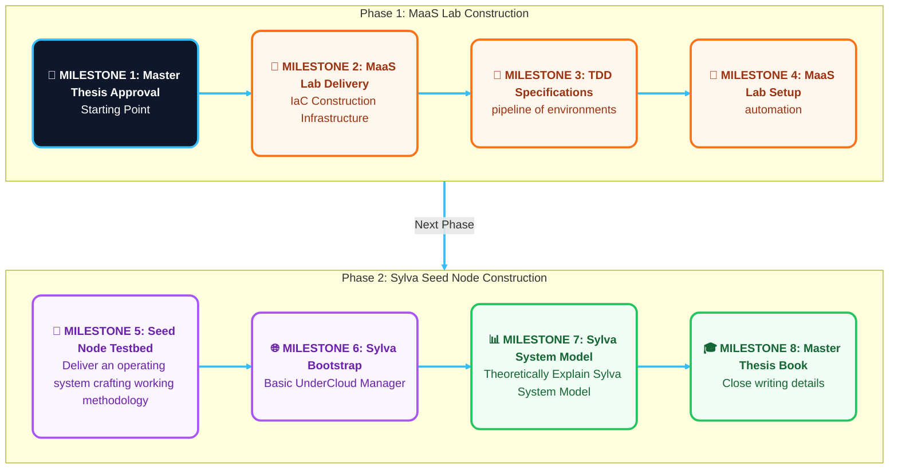
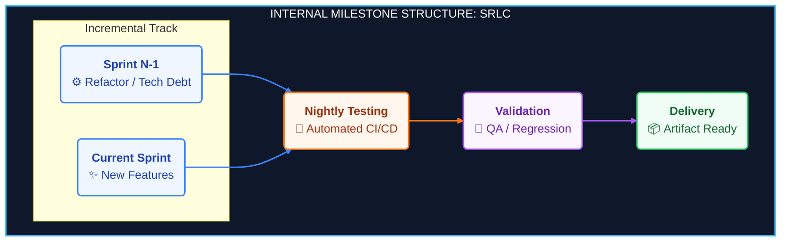

# Milestone 1: Master's Thesis Proposal / Anteproyecto del TFG o TFM

## Thesis Supervisors and Details / Responsables y Detalles del Trabajo

[ui-tabs position="top" active="1" theme="lite"]
[ui-tab title="🇬🇧 English"]

**PROJECT:** Seed Node Design for Sylva Project

* **Student:** César Delgado González
* **ID Number:** 52.477.282-E
* **Email:** [cesar.delgado.gonzalez@alumnos.upm.es](mailto:cesar.delgado.gonzalez@alumnos.upm.es)
* **Degree:** Bachelor of Engineering in Telecommunication Systems Engineering
* **Academic Supervisor:** Iván Pau de la Cruz — [ivan.pau@upm.es](mailto:ivan.pau@upm.es)
* **Department:** Department of Telematics and Electronic Engineering

[/ui-tab]
[ui-tab title="🇪🇸 Español"]

**PROYECTO:** Diseño de Nodo Semilla para Proyecto Sylva

* **Alumno:** César Delgado González
* **DNI:** 52.477.282-E
* **Email:** [cesar.delgado.gonzalez@alumnos.upm.es](mailto:cesar.delgado.gonzalez@alumnos.upm.es)
* **Titulación:** Grado en Ingeniería de Sistemas de Telecomunicación
* **Supervisor Académico:** Iván Pau de la Cruz — [ivan.pau@upm.es](mailto:ivan.pau@upm.es)
* **Departamento:** Departamento de Ingeniería Telemática y Electrónica

[/ui-tab]
[/ui-tabs]

## Description of the Thesis / Descripción del Trabajo

### 1.- Introduction / Introducción

[ui-tabs position="top" active="1" theme="lite"]
[ui-tab title="🇬🇧 English"]

**The Genesis Node is a highly adaptable Seed Node inspired by AT&T's Airship Genesis node and built on OpenStack Ironic (Bifrost).** Capable of provisioning any bare-metal environment, it is used here to bootstrap the Sylva project from a Talos Linux instance. This streamlines the coordination of multiple distributed Sylva deployments through a more robust bootstrap process, with the option to integrate monitoring tools for the CPD control plane nodes.

[/ui-tab]
[ui-tab title="🇪🇸 Español"]

**El Nodo Genesis es un Nodo Semilla altamente adaptable, inspirado en el nodo Genesis de Airship de AT&T y desarrollado sobre OpenStack Ironic (Bifrost).** Capaz de aprovisionar cualquier servidor físico (bare-metal), se utiliza en este escenario para inicializar el proyecto Sylva desde una instancia de Talos Linux. Esto optimiza la coordinación de múltiples despliegues distribuidos de Sylva gracias a un proceso de arranque más robusto y con la opción de integrar herramientas de monitorización de nodos del plano de control del CPD. 

[/ui-tab]
[/ui-tabs]

### 2.- Objectives / Objetivos

[ui-tabs position="top" active="1" theme="lite"]
[ui-tab title="🇬🇧 English"]

**The primary goal is a unified Undercloud Manager** able to orchestrate three distinct use cases:
- <u>Sylva Validation Center:</u> A dedicated environment to certify Virtualized Network Functions (CNFs).
- <u>Fraunhofer FOKUS Cellular Network Emulators:</u> A platform to explore private enterprise 5G/6G network deployments, focusing on low-latency and highly secure communications for industrial IoT applications like factory robotics orchestration.
- <u>Software Factory Vendor Lock-In Free:</u> Modern software production pipelines that shift away from the traditional "functionality-first" approach, integrating security and quality natively into the software development lifecycle rather than treating them as post-production add-ons. By equipping software factories with this production infrastructure, a secure software supply chain can be standardized across the continental industry, the aim of European directives such NIS2. <i>Artificial Intelligence software factories and datacenters are relevant use cases within this ecosystem.</i>

[/ui-tab]
[ui-tab title="🇪🇸 Español"]

**El objetivo principal es un Gestor de Undercloud Unificado** capaz de desplegar tres casos de uso:
- <u>Centro de Validación de Sylva:</u> Entorno dedicado a certificar funciones de red virtualizadas (CNFs).
- <u>Emuladores de Redes Celulares de Fraunhofer FOKUS:</u> Una plataforma para explorar el despliegue de redes privadas empresariales 5G/6G, enfocada en comunicaciones seguras y de baja latencia para aplicaciones industriales IoT, como la orquestación de la robótica en las fábricas.
- <u>Factoría Software sin Vendor Lock-in:</u> Líneas de producción de software modernas que se alejan del enfoque tradicional de "priorizar la funcionalidad", integrando la seguridad y la calidad de forma nativa en el ciclo de desarrollo de software, en lugar de tratarlas como añadidos postproducción. Al dotar a las factorías de esta infraestructura de producción, se puede estandarizar una cadena de suministro de software segura en toda la industria continental, la finalidad de directivas europeas como NIS2. <i>Centros de datos y factorías software de aplicaciones de Inteligencia Artificial son casos de usos de especial interés dentro de este ecosistema.</i>

[/ui-tab]
[/ui-tabs]

#### 3.1. Methodology / Metodología

[ui-tabs position="top" active="1" theme="lite"]
[ui-tab title="🇬🇧 English"]

  
  <!-- Primer bloque: 2 filas superiores (fondo gris claro nativo: bg-gray) -->
  

    

      Design
    

    

      

        <b>Architecture – Declarative Infrastructure as Code (API oriented):</b> inspired by the Sylva Hardware Validation Center as part of the KubeRef project specified in Anuket  RI2, but for servers.
        <ul>
		<li><u>Seed Node Lifecycle Modeling (hosts/target):</u> Implemented via Ansible and adjustable through an API, where activities of lifecycle can be configured.</li>
        <li><u>Ironic BareMetal Node Lifecycle Modeling (hosts/test):</u> Ansible API to easily express and enforce desired hardware configurations to be transformed into Ironic or ansible calls.</li>
		</ul>
	  

      

       <b>Delivery Cycle - Evolutionary Prototyping.</b> 
       Following the timeline on the next section, each project stage delivers an updated and iteratively improved version of the initial prototype.  
	  

    

  

  <!-- Segundo bloque: 2 filas inferiores (fondo secundario nativo: bg-secondary) -->
  

    

      Construction
    

    

      

       <b> Methodology (Activities Ordering) - Milestone-Driven Agile </b>  
       Each project phase is divided into sprints focused on research, testing, or feature development. Each sprint has its own dedicated Git branch, which is merged into the main branch upon final validation. This branching structure ensures full evolutionary traceability.
       Because features are defined dynamically through ongoing research, sprint structures adapt fluidly, nevertheless every sprint follows Deming Cycle stages (reflected as commit comment):
	   <ul>
         <li><u>Stage 1: Specification:</u> Define features/tests in the MaaS Lab documentation site.</li>
         <li><u>Stage 2: Preparation:</u> Set up the testing environment in MaaS Lab.</li>
         <li><u>Stage 3: Validation:</u> Execute tests and verify results.</li>
         <li><u>Stage 4: Delivery:</u> Deploy the validated feature or test.</li>
		 </ul>
	  

      

       <b>Construction - Test-Driven Development (TDD)</b>
        <ul> 
		<li><u>MaaS Lab (IaC):</u> Developing Infrastructure as Code (IaC) is like sculpting stone; TDD acts as the angle grinder that shapes the environment, ensuring all configurations are automatically verified during nightly continuous testing cycles.</li>
        <li><u>MaaS Documentation Server:</u> Hosts the API definitions and test specifications that drive the entire TDD workflow.</li>
		</ul>
      

    

  

[/ui-tab]
[ui-tab title="🇪🇸 Español"]

  
  <!-- Primer bloque: 2 filas superiores (fondo gris claro nativo: bg-gray) -->
  

    

      Diseño
    

    

      

        <b>Arquitectura – Infraestructura como Código netamente Declarativa (orientada a API):</b> inspirado en el Centro de Validación Hardware de Sylva -parte del proyecto KubeRef acorde con las especificaciones en Anuket-RI2-, pero para servidores individuales.
        <ul>
		<li><u>-	Modelado del ciclo de vida del Nodo Semilla (hosts/target):</u> Implementado en Ansible y ajustable a través de una API donde las actividades del ciclo pueden ser configuradas.</li>
        <li><u>-	Modelado del ciclo de vida nodos físicos de Ironic (hosts/test):</u> Crea una API en Ansible para expresar y aplicar con facilidad configuraciones de hardware deseadas, y serán mapeadas bien a la API de Ironic, bien a módulos ansible.</li>
		</ul>
	  

      

       <b>Ciclo de Entregas - Prototipado Evolutivo.</b> 
       Siguiendo el cronograma de la siguiente página, cada etapa del proyecto entrega una iteración actualizada y mejorada del prototipo inicial.  
	  

    

  

  <!-- Segundo bloque: 2 filas inferiores (fondo secundario nativo: bg-secondary) -->
  

    

      Construcción
    

    

      

       <b> Metodología (Gestión de Actividades): Ágil orientada a Hitos.</b>  
       Cada fase del proyecto se divide en sprints centrados en la investigación, las pruebas o el desarrollo de funcionalidades. Cada sprint tiene su rama Git dedicada que se fusionará en la rama principal (main) tras su validación final, aportando trazabilidad al desarrollo.
       Dado que las funcionalidades se definen de forma dinámica a través de la investigación en curso, la estructura de los sprints se adapta con fluidez. No obstante, cada uno de ellos sigue las cuatro etapas del ciclo de Deming (señaladas en los comentarios de los commit de la rama):
	   <ul>
         <li><u>Etapa 1: Especificación:</u> Definir la funcionalidad o la pruebas en la web de MaaS Lab.</li>
         <li><u>Etapa 2: Preparación:</u> Configurar el entorno de pruebas en MaaS Lab.</li>
         <li><u>Etapa 3: Validación:</u> Ejecutar las pruebas y verificar los resultados.</li>
         <li><u>Etapa 4: Entrega:</u> Desplegar la funcionalidad o prueba validada.</li>
		 </ul>
	  

      

	  <b>Construcción - Desarrollo Guiado por Pruebas (TDD=Test Driven Design)</b>
	  <ul>
       <li><u>MaaS Lab (IaC):</u> El desarrollo de Infraestructura como Código (IaC) es como esculpir en piedra; TDD actúa como la radial que da forma al entorno, garantizando que todas las configuraciones se verifiquen automáticamente en ciclos de pruebas continuas cada noche.</li>
       <li><u>Servidor de Documentación de MaaS:</u> Alberga las definiciones de las API y las especificaciones de las pruebas que impulsan todo el flujo de trabajo de TDD.</li>
	   </ul>
	  

    

  

[/ui-tab]
[/ui-tabs]

#### 3.2. Activities and Timeline / Actividades y Cronograma

Macro Project Roadmap (SDLC Lifecycle) / Cronograma Global de Hitos

***

Milestone Internal Structure (SRLC Progression) / Estructura Interna del Hito (Progreso SRLC)

### 4. Materials and Resources / Materiales y Recursos a Utilizar

[ui-tabs position="top" active="1" theme="lite"]
[ui-tab title="🇬🇧 English"]

*Note: All materials are self-provided; no university resources are required.*

*   **Personal Computer:** Windows 11 equipped with WSL (Windows Subsystem for Linux) and MobaXterm.
*   **Virtualization Server:** Equipped with 128 GB RAM, 3 TB HDD storage, running Proxmox VE 9.2.
*   **Git Repository:** Hosted environment for codebase management and version control.

[/ui-tab]
[ui-tab title="🇪🇸 Español"]

*Nota: Todo el material es propio; no se requieren recursos de la universidad.*

*   **Ordenador Personal:** Windows 11 equipado con WSL (Subsistema de Windows para Linux) y MobaXterm.
*   **Servidor de Virtualización:** Equipado con 128 GB de RAM, 3 TB de almacenamiento HDD, ejecutando Proxmox VE 9.2.
*   **Repositorio Git:** Entorno alojado para la gestión del código fuente y el control de versiones.

[/ui-tab]
[/ui-tabs]

### 5. Expected Results / Resultados Previstos

[ui-tabs position="top" active="1" theme="lite"]
[ui-tab title="🇬🇧 English"]

*   **MaaS (Metal as a Service) Lab:** Establish a testing infrastructure that enables the design and provisioning of configurations for any set of physical or virtual machines, delivered via Ansible Collections:
    *   `genesis.stage`: Seed Node Lifecycle Modelling.
    *   `genesis.service`: Functional components to configure bare-metal nodes, including their respective unit tests.
*   **Sylva Bootstrap:** Deploy a minimal working environment and theoretically illustrate the structural model of the Sylva system.

[/ui-tab]
[ui-tab title="🇪🇸 Español"]

*   **MaaS (Metal as a Service) Lab:** Establecer una infraestructura de pruebas que permita diseñar y aprovisionar las configuraciones de cualquier conjunto de máquinas físicas o virtuales, entregada mediante Colecciones de Ansible:
    *   `genesis.stage`: Modelado del ciclo de vida del Nodo Semilla.
    *   `genesis.service`: Componentes funcionales para configurar los nodos físicos, incluyendo sus respectivas pruebas unitarias.
*   **Bootstrap de Sylva:** Desplegar un entorno mínimo de trabajo e ilustrar teóricamente el modelo estructural del sistema Sylva.

[/ui-tab]
[/ui-tabs]

### 6. Bibliography / Bibliografía

#### System Model / Modelo Sistema
*   **CNTT (Cloud iNfrastructure Telco Taskforce):** Reference model specs. [cntt.readthedocs.io](https://readthedocs.io)
*   **Anuket:** Linux Foundation open-source infrastructure specifications. [anuket.io](https://anuket.io)
*   **Sylva Project:** Cloud software framework tailored for telco and edge requirements. [sylvaproject.org](https://sylvaproject.org)

#### Infrastructure Model / Modelo Infraestructura
*   **Ironic:** Open-source project that fully manages bare-metal server lifecycles. [ironicbaremetal.org](https://ironicbaremetal.org)
*   **Metal3:** Bare-metal host provisioning and management tools infrastructure provider for Kubernetes. [metal3.io](https://metal3.io)

#### Use Cases / Casos de Uso
*   **Sylva Validation Center:** Leading vendors to higher cloud nativeness and security levels. [sylvaproject.org/validation-center-leading-vendors-to-higher-cloud-nativeness-levels/](https://sylvaproject.orgvalidation-center-leading-vendors-to-higher-cloud-nativeness-levels/)
*   **Fraunhofer FOKUS:** Advanced 5G/6G cellular network emulators toolkit (Open6GCore). [open6gcore.org](https://open6gcore.org)
*   **DevSecOps Software Factories:**
    *   *US National Security:* Secure enterprise software development platform. [p1.dso.mil](https://dso.mil)
    *   *Dr. Allan Friedman:* Transparency and SBOM movement in the software value chain. [securityandtechnology.org/person/allan-friedman/](https://securityandtechnology.org)

